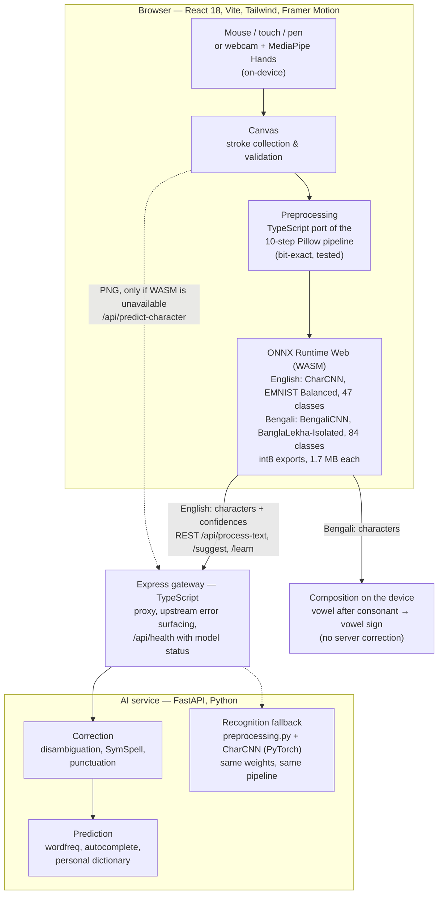
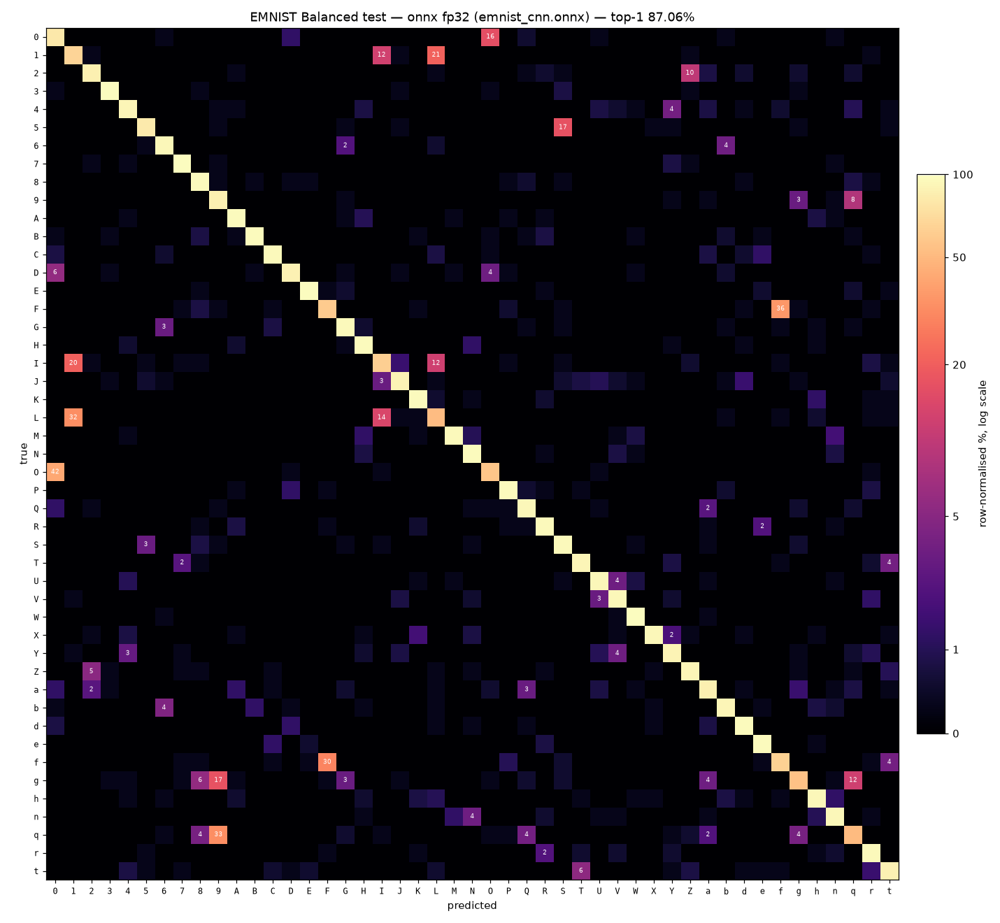
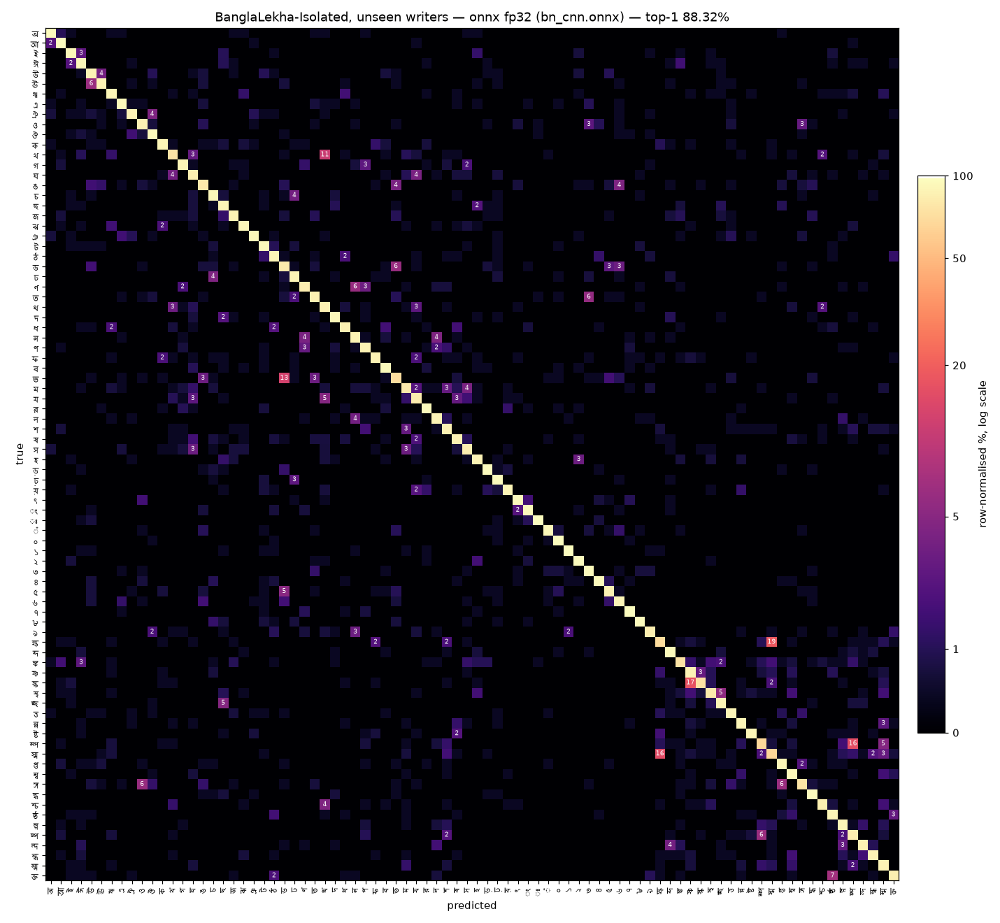

# AirScript — touchless air writing and drawing

Write or draw in the air with your hand, or with a mouse or finger, and watch a
CNN plus an NLP pipeline turn the strokes into corrected text, in English or
in Bengali (বাংলা). Hand tracking (MediaPipe) and character recognition (ONNX
Runtime Web) both run in the browser; only the recognised characters go to
the server, for correction.

**Try it:** [https://airscript-frontend.vercel.app](https://airscript-frontend.vercel.app)
— no webcam needed. Draw with the mouse, or press *Replay a sample* and the app
demonstrates itself. Hand tracking is an opt-in upgrade ("Use your hand instead").

## Architecture



Characters are recognised on the user's device: the strokes are painted to an
off-screen canvas, preprocessed by a TypeScript port of `preprocessing.py`
that matches it bit for bit (see [Checks](#checks)), and classified by the
same CharCNN weights exported to ONNX. The Python service keeps the correction
and prediction pipeline, and still serves recognition as a fallback for
browsers where WebAssembly fails. The Express layer never does inference; it
only routes. The personal dictionary is the one piece of state that persists
between sessions — it learns from corrections the user makes.

The client talks to whatever `VITE_API_BASE_URL` points at. Locally that is
`/api` (the gateway, proxied by Vite). The public frontend points straight at
the Hugging Face Space because the free tiers in use do not host the gateway;
the gateway is still the path exercised by the local setup and its tests.

## Live deployment

| Tier | URL | Notes |
|------|-----|-------|
| Frontend | https://airscript-frontend.vercel.app | Vercel. Deployed with the Vercel CLI, not from git: the live site is whatever was last pushed with `vercel --prod`. |
| AI service | https://saminul-amin-airscript-backend.hf.space | Hugging Face Space, free CPU tier. **Sleeps when idle**: the first request after a quiet period takes up to a minute. Recognition does not depend on it; correction waits for it and the app says so. A daily Vercel cron (`client/api/keep-warm.js`) pings `/health` so it idles less. `GET /health` reports whether trained weights are loaded. |

## Recognition on your device

The browser loads three things after first paint, without blocking drawing:
the ONNX Runtime Web JS bundle (73 KB), its WebAssembly binary (14.2 MB raw,
3.7 MB gzip, 2.3 MB brotli, cached after the first visit), and the model for
the selected script. The other script's model loads when you switch to it.
Two exports of each model are committed, all hashed into the build:

| Export | File | Size | Benchmark top-1 | Load (Chrome, this machine, dev server) | Per character (median) |
|---|---|---|---|---|---|
| English int8 (**default**) | `emnist_cnn.int8.onnx` | 1.72 MB (1.0 MB brotli) | 87.04 % | 864 ms first visit, 270–500 ms cached | 61 ms = 39.5 ms preprocessing + 22 ms inference |
| English fp32 | `emnist_cnn.onnx` | 6.85 MB (6.3 MB brotli) | 87.06 % | 565 ms cached | 44 ms = 38.9 ms preprocessing + 4.6 ms inference |
| Bengali int8 (**default**) | `bn_cnn.int8.onnx` | 1.73 MB | 88.27 % | 64 ms when switching (runtime already loaded) | 71 ms = 43 ms preprocessing + 28 ms inference |
| Bengali fp32 | `bn_cnn.onnx` | 6.88 MB | 88.32 % | not measured | not measured |

The int8 exports are shipped because they cost 0.02–0.05 percentage points
of accuracy for a quarter of the download; their integer kernels are slower
in WASM than fp32 floats, but both are well under the one-second pause that
triggers recognition. `?model=fp32` (or `VITE_LOCAL_MODEL=fp32`) switches.
`?recognition=server` (or `VITE_RECOGNITION=server`) disables on-device
recognition to exercise the fallback (English only: the server has no
Bengali model). Timings come from `window.__airscriptRecognition` in a dev
build.

What the server is still for: `/process-text` (correction), `/suggest` and
`/autocomplete` (word prediction) and `/learn` (personal dictionary). When it
is asleep or unreachable, characters still appear immediately, the raw text
is shown with a note, and the correction is applied once `/health` answers
again.

## Accuracy

Everything below was produced by `ai-service/evaluate.py` on 17 October 2026
and is stored in [`docs/accuracy-emnist.json`](docs/accuracy-emnist.json).
Nothing here is estimated.

**EMNIST Balanced, test split, 18,800 samples, 47 classes**

| Model | Top-1 | Top-3 |
|---|---|---|
| PyTorch (`emnist_cnn.pth`) | 87.06 % | 98.59 % |
| ONNX fp32 (`emnist_cnn.onnx`) | 87.06 % | 98.59 % |
| ONNX int8 (`emnist_cnn.int8.onnx`) | 87.04 % | 98.59 % |

PyTorch and the fp32 export agree on the top-1 class for all 18,800 samples;
the largest logit difference is 9.5 × 10⁻⁶.



The ten most confused pairs (true → predicted, share of the true class):
`O`→`0` 42.2 %, `F`→`f` 36.2 %, `q`→`9` 32.8 %, `L`→`1` 32.5 %, `f`→`F` 29.8 %,
`1`→`L` 21.0 %, `I`→`1` 20.5 %, `g`→`9` 17.2 %, `5`→`S` 17.0 %, `0`→`O` 16.2 %.
EMNIST Balanced deliberately merges fifteen lowercase letters into their
uppercase class (c, i, j, k, l, m, o, p, s, u, v, w, x, y, z), so `L` contains
handwritten `l`, which is why `L`/`1`/`I` and `O`/`0` dominate: the shapes are
the same and only context can separate them. That is the job of the
correction pipeline, which turns `HELL0` into `Hello`.

**Bengali: BanglaLekha-Isolated, held-out writers, 24,851 samples, 84 classes.**
Produced by `ai-service/evaluate_bn.py` on 17 October 2026, stored in
[`docs/accuracy-bengali.json`](docs/accuracy-bengali.json). The split is by
handwriting form, so none of these writers was seen in training.

| Model | Top-1 | Top-3 |
|---|---|---|
| PyTorch (`bn_cnn.pth`) | 88.32 % | 96.00 % |
| ONNX fp32 (`bn_cnn.onnx`) | 88.32 % | 96.00 % |
| ONNX int8 (`bn_cnn.int8.onnx`) | 88.27 % | 95.96 % |



The ten most confused pairs: `ক্ষ`→`স্ম` 18.5 %, `স্ক`→`ষ্ণ` 16.8 %,
`ম্প`→`ষ্প` 16.3 %, `স্ম`→`ক্ষ` 15.6 %, `ভ`→`ড` 12.9 %, `খ`→`থ` 11.2 %,
`ক্ত`→`ষ্ঠ` 7.1 %, `ষ্প`→`ম্প` 6.4 %, `ঊ`→`উ` 6.4 %, `ঙ্গ`→`প্ত` 6.4 %. Basic
letters and digits are strong; the errors concentrate in the compound
characters, which share sub-shapes and sit at the limit of a 28×28 input.
Training ran 12 epochs on CPU (100 minutes) and validation accuracy was
still rising slowly, so this is not a converged figure.

**Real strokes: pending.** A benchmark number is not a real-world number: the
app's strokes are smoother and thicker than EMNIST's scanned pen on paper,
drawn with a mouse or in the air, and sized by the drawing surface rather
than by a scanner. The app has a dev-only recorder (`/?record=1`) that
prompts for each of the 47 classes, captures the strokes and the exact PNG
the recogniser sees, and exports labelled JSON.
`npm run evaluate:real-strokes` in `client/` then runs that set through the
same TypeScript preprocessing and ONNX Runtime the browser uses and writes
`docs/accuracy-real-strokes.json`. The set has not been drawn yet, so there
is no real-strokes figure to report.

## Bengali (বাংলা)

Switch the script with the English / বাংলা control in the top bar. Bengali
recognition runs in the browser too, with its own model
(`ai-service/model_bn.py`, `BengaliCNN`: the same layer plan as `CharCNN`,
separate module and weights) trained on
[BanglaLekha-Isolated](https://data.mendeley.com/datasets/hf6sf8zrkc/2)
(Biswas et al., 2017, Data in Brief 12:103–107, doi:10.1016/j.dib.2017.03.035),
licensed **CC BY 4.0**, which allows publishing weights trained on it with
attribution. Ekush and CMATERdb were considered and passed over because
neither states a licence. The dataset (197 MB zip, 166,105 images) is
downloaded to a folder outside the repo (`AIRSCRIPT_BN_DATA_DIR`) and never
committed.

**What v1 recognises:** 84 isolated characters, the dataset's classes: the
11 vowels, 39 consonants (including ড় ঢ় য় ৎ ং ঃ ঁ), 10 digits and 24
compound characters. The folder-to-character mapping for the 60 basic
classes was verified against the handwriting; the 24 compound labels are a
reading by eye (`COMPOUNDS` in `model_bn.py`) that still needs a native
speaker's check. A wrong label is a string change in two files, not a
retraining.

**Composition rule.** Bengali words attach vowel signs (কার) to consonants,
and the model only knows isolated characters, so the app composes: an
independent vowel recognised right after a consonant (or a compound) becomes
that vowel's sign — ক then ই reads কি, and ব আ ং ল আ reads বাংলা. অ after a
consonant is dropped (it is the inherent vowel). A vowel at the start of a
word, after a digit, after a space, or after ৎ ং ঃ ঁ stays independent.
`client/src/recognition/bengali.ts`, tested in `client/tests/bengali.test.ts`.

**What v1 cannot write:** an independent vowel directly after a consonant
inside a word (বই, কই, দই — put a space before the vowel), conjuncts outside
the dataset's 24, anything needing a hasanta (্) or the য-ফলা / র-ফলা forms,
and punctuation. There is no spelling correction or word prediction in
Bengali; the app says so under the text. A Bengali word list from wordfreq is
a possible next step, not done.

Bengali is drawn with thicker ink than English (11 px instead of 4) because
the training data is thick, edge-thickened scans; the three Bengali replay
samples (কাক, দাদা, ২০২৫) are polylines traced from a printed font
(`ai-service/tools/bn_glyph_strokes.py`) and were checked to read as intended
through the browser pipeline (`npm run check:samples`, and in Chrome). A
বাংলা sample was tried and dropped: a traced ল sits on the ল/ন decision
boundary and reads as ন in Chrome, which is itself a fair picture of where
the model is weak. The UI sets Bengali in Noto Sans Bengali (SIL Open Font
License, from Google Fonts).

To retrain: put the extracted dataset on E: (or set `AIRSCRIPT_BN_DATA_DIR`),
then in `ai-service/`:

```bash
python preprocessing_bn.py          # cache the 28×28 inputs (~10 min, 12 workers)
python train_bn.py --estimate       # per-epoch time on this machine
python train_bn.py                  # writes saved_model/bn_cnn.pth + .sha256
python export_onnx_bn.py --quantize # bn_cnn.onnx, bn_cnn.int8.onnx + checksums
python evaluate_bn.py               # docs/accuracy-bengali.json + confusion matrix
cp saved_model/bn_cnn*.onnx ../client/models/
```

## The model and its weights

`ai-service/model.py` defines `CharCNN`, trained on EMNIST Balanced with
`train.py`. The trained checkpoint is committed at
`ai-service/saved_model/emnist_cnn.pth` (6.8 MB) next to its SHA-256 in
`emnist_cnn.sha256`. Two ONNX exports of the same weights sit beside it
(`emnist_cnn.onnx`, `emnist_cnn.int8.onnx`), each with its own `.sha256`, and
`client/models/` holds byte-identical copies for the browser (a client test
fails if they drift).

```bash
cd ai-service
pip install -r requirements-export.txt
python export_onnx.py --quantize     # rewrites the .onnx files and their checksums
cp saved_model/*.onnx ../client/models/
python evaluate.py                   # EMNIST metrics + docs/confusion-matrix-emnist.png
```

The service **refuses to start** if the `.pth` is missing, cannot be loaded
into `CharCNN`, or does not match the pinned checksum. It never serves
predictions from an untrained network. To supply weights another way:

- set `AIRSCRIPT_MODEL_PATH` to a different `.pth`, or
- set `AIRSCRIPT_MODEL_URL` to a downloadable file (for example a Hugging Face
  model file or a GitHub Release asset); it is fetched once at startup, or
- retrain: `pip install -r requirements-train.txt && python train.py`
  (downloads EMNIST, ~2 GB, and writes a new `.pth` — update the `.sha256`
  file with the new checksum, re-export, re-evaluate).

`AIRSCRIPT_ALLOW_MISSING_MODEL=1` starts the text endpoints without a model for
development; `/predict` then answers `503` and `/health` reports `degraded`.
Do not set it in production.

Do not change the layer shapes in `model.py` or the 10-step pipeline in
`preprocessing.py` without retraining; the checkpoint, the ONNX exports, the
TypeScript port and the tests all pin them.

## Project structure

```
air-script/
├── ai-service/            # Python FastAPI — correction pipeline, NLP, recognition fallback
│   ├── correction/        # Spell correction, disambiguation, punctuation
│   ├── nlp/               # Word prediction, autocomplete, personal dictionary
│   ├── saved_model/       # emnist_cnn + bn_cnn: .pth, .onnx, .int8.onnx, each with a .sha256
│   ├── model_cards/       # Hugging Face model cards (English, Bengali), ready to publish
│   ├── tests/             # pytest: preprocessing, correction, API, ONNX agreement
│   ├── tools/             # fixture recorder for the TS parity test, confusion plotter
│   ├── model.py           # CharCNN architecture (do not change shapes)
│   ├── model_bn.py        # BengaliCNN + the 84 BanglaLekha labels
│   ├── preprocessing_bn.py # dataset → cached 28×28 inputs, by-writer split
│   ├── train_bn.py / export_onnx_bn.py / evaluate_bn.py
│   ├── preprocessing.py   # 10-step image pipeline (pinned by tests and the TS port)
│   ├── model_loader.py    # Strict loader: checksum, TorchScript trace
│   ├── export_onnx.py     # .pth → ONNX (+ int8), checksums, agreement report
│   ├── evaluate.py        # EMNIST metrics, confusion matrix, most confused pairs
│   ├── emnist_data.py     # Reads the EMNIST IDX files without torchvision
│   ├── predict.py         # Inference → top-3 labels with confidences
│   ├── main.py            # FastAPI app, /health, fail-loud startup
│   ├── train.py           # Training script (EMNIST Balanced)
│   ├── Dockerfile         # CPU-only image for Hugging Face Spaces
│   └── README.md          # Space card (YAML front matter)
├── server/                # Node/Express gateway
│   ├── src/               # config, routes, controllers, services, types
│   └── tests/             # vitest: proxying and upstream error surfacing
├── client/                # React 18 + Vite + Tailwind + Framer Motion
│   ├── models/            # ONNX exports the browser downloads (hashed by Vite)
│   ├── src/recognition/   # preprocess.ts (Pillow port), ORT loader, labels, softmax
│   ├── src/components/    # Canvas, panels, TopBar, ConnectionStrip, RecorderPanel…
│   ├── src/hooks/         # useCanvas, useWordBuilder, useLocalRecognizer,
│   │                      # useServiceStatus, useSampleReplay, useRecorder…
│   ├── src/data/          # Recorded sample strokes for "Replay a sample"
│   ├── scripts/           # fixture renderer, real-strokes evaluator (vite-node)
│   ├── tests/             # vitest + Testing Library; fixtures/preprocessing (70 PNGs + expected.json)
│   └── api/               # Vercel cron: keep the Space awake
└── docs/                  # problem definition, proposal, design plan, accuracy reports
```

## Local setup

Prerequisites: Python 3.10+, Node.js 18+. A webcam is optional.

### 1. AI service (port 8000)

```bash
cd ai-service
python -m venv venv
venv\Scripts\activate          # macOS/Linux: source venv/bin/activate
pip install -r requirements.txt
uvicorn main:app --port 8000 --reload
```

`requirements.txt` pulls CPU-only PyTorch from the official CPU wheel index.
Check it: `curl http://localhost:8000/health` should show `"loaded": true`.

### 2. Gateway (port 5000)

```bash
cd server
npm install
cp .env.example .env            # optional; defaults point at localhost:8000
npm run dev
```

### 3. Client (port 3000)

```bash
cd client
npm install
npm run dev
```

Open http://localhost:3000. Draw a letter with the mouse; after a one-second
pause it is recognised in the browser, and after a word boundary (Space) it is
corrected by the service. Start the client alone and recognition still works;
the top bar then shows the correction service as waking or offline.

Configuration is by environment variables only; each tier has a committed
`.env.example`, and `.env*` files are git-ignored. Set
`VITE_API_BASE_URL` in `client/.env.local` to point the client somewhere else
(for example straight at the Space, with no `/api` suffix).

## Checks

There is no CI; run these locally. Each tier has one command.

| Tier | Command | What it covers |
|------|---------|----------------|
| ai-service | `pip install -r requirements-dev.txt && pytest` | preprocessing shape/normalisation, correction pipeline (known input → known output), `/predict` and `/health` through `TestClient`, refusal to start without valid weights, and the ONNX exports: pinned checksums, graph contract, PyTorch agreement on random inputs and on the EMNIST test split (top-1 agreement ≥ 99.9 %, int8 within 0.5 pp of fp32). The EMNIST tests skip with a message when the data is not under `data/EMNIST/raw` (run `train.py` once or set `AIRSCRIPT_EMNIST_DIR`). |
| server | `npm run check` | typecheck + gateway proxies JSON and multipart, surfaces upstream status and detail, `/api/health` reports model status |
| client | `npm run check` | typecheck + stroke validation and payload conversion; the word builder (recognition timing, on-device path, server fallback, correction retry when the service is unreachable, Bengali composition with no server call); the Bengali label set and composition rule; the stroke recorder; **preprocessing parity**: the TypeScript port against `preprocessing.py` on 70 fixtures (currently 70/70 bit-exact, tolerance one grey level), and the ONNX top-1 from the TypeScript input equals the one from the Python input on every fixture for all four exports; `client/models` matches the checksums in `ai-service/saved_model` |

`npm run check:samples` in `client/` runs every replay sample through the
browser pipeline and reports what the models read (expected: every Bengali
glyph as intended; in English, O reads as 0 and I as L until correction).

The **How it works** panel in the app (top bar) shows the pipeline, the
accuracy tables and the confusion matrices. Its numbers are generated from
`docs/accuracy-*.json` by `npm run sync:accuracy`
(`client/src/data/accuracy.generated.ts` plus the matrix images under
`client/src/assets`), and a client test fails if that copy is stale, so the
app can never show a number that was not measured.

Regenerating the parity fixtures after a change to `paintStrokes` or the sample data:

```bash
cd client && npm run fixtures:preprocessing
cd ../ai-service && python tools/make_preprocessing_fixtures.py
```

## Deploying

**AI service → Hugging Face Space** (Docker SDK, port 7860). The Space is the
`ai-service/` folder; `ai-service/README.md` is the Space card.

```bash
pip install -U huggingface_hub
hf auth login
hf upload saminul-amin/airscript-backend ai-service . --repo-type space --exclude "venv/*" "__pycache__/*" "data/*" "tests/*" "*.onnx"
```

Then confirm `https://saminul-amin-airscript-backend.hf.space/health` returns
`"loaded": true` with the checksum from `saved_model/emnist_cnn.sha256`.

**Frontend → Vercel** from the `client/` directory. Set `VITE_API_BASE_URL` to
the Space URL in the Vercel project, then:

```bash
cd client
vercel --prod
```

Keep the `crons` entry in `client/vercel.json` while the client still calls
the Space for correction.

## Using it

- **Mouse / touch** is the default input. Draw one character at a time; lift
  the pointer and wait a second.
- **Replay a sample** plays a recorded stroke sequence through the same
  pipeline so you can see recognition and correction without drawing.
- **Use your hand instead** turns on the webcam and MediaPipe. Point with the
  index finger to draw, close the fist to pause, open the palm to clear.
  Video stays in the browser.
- **Write** mode recognises characters and builds corrected text with
  suggestions; **Draw** mode is a free canvas with colours and export.
- Press `?` for keyboard shortcuts.
- `/?record=1` opens the dev-only stroke recorder (see [Accuracy](#accuracy));
  `/?recognition=server` forces the server fallback; `/?model=fp32` loads the
  float export.

## Licences

Code: MIT, see [LICENSE](LICENSE). Runtime dependencies added for on-device
recognition are MIT (onnxruntime-web; onnxruntime-node, @napi-rs/canvas and
pngjs for the tests only). The English model is trained on EMNIST (Cohen,
Afshar, Tapson, van Schaik, 2017, *EMNIST: an extension of MNIST to
handwritten letters*), derived from NIST Special Database 19. The Bengali
model is trained on BanglaLekha-Isolated (Biswas et al., 2017), CC BY 4.0.
Neither dataset is redistributed here. Fonts (Fraunces, Inter, JetBrains
Mono, Noto Sans Bengali) are loaded from Google Fonts under the SIL Open Font
License.

## Author

**Md. Saminul Amin** — [GitHub](https://github.com/saminul-amin) ·
[LinkedIn](https://linkedin.com/in/md-saminul-amin/) · saminul.amin@gmail.com
